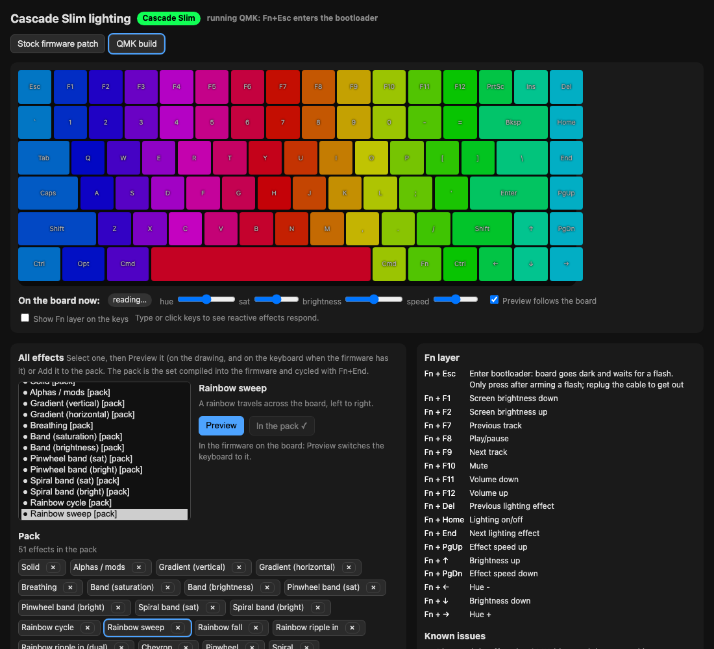
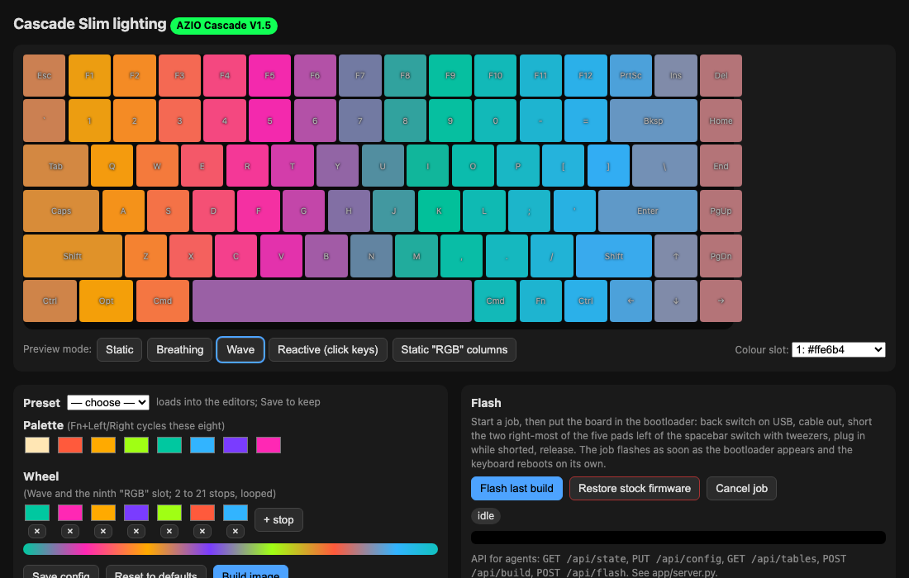

# cascade-qmk

Custom lighting and [QMK](https://qmk.fm) firmware for the **AZIO Cascade Slim** (and, untested, the
full-height Cascade, which Azio's FCC filing says is the same board).

The Cascade ships with 4 lighting modes and 9 colours, no software, and a Windows-only
firmware updater. It turns out the main chip is a Sonix SN32F248B, the same family
[SonixQMK](https://github.com/SonixQMK/qmk_firmware) already targets, and the board is
electrically a near twin of the Keychron K2. So this repo gives you two things:

1. **A stock-firmware patch**: your own 8 colours and your own rainbow, in Azio's firmware,
   Bluetooth and all. No code changes beyond a small patch that makes Wave follow your wheel.
2. **A full QMK port**: every key verified, per-key RGB with 49 QMK effects plus two custom
   ones, VIA, a Fn+Esc bootloader key, and a local web app + JSON API to preview, pick, build,
   flash, and change the lighting live over USB.



## Status

| | |
|---|---|
| Key matrix | 84 keys verified on hardware |
| Lighting | all 84 LEDs, right colours, right keys |
| Effects | 49 built-in + Drift + Fireflies, selectable "pack" |
| Live control | VIA raw HID: read/set effect, hue, sat, brightness, speed |
| Bluetooth | **wired only under QMK** (the Bluetooth module is a separate chip on SPI; protocol not done) |
| Recovery | the Sonix ROM bootloader is always reachable; stock firmware is one flash away |

## Safety and legal, read this

- **This rewrites your keyboard's firmware.** It has worked on one board, mine. The ROM
  bootloader cannot be overwritten, so a bad flash is recoverable, but you accept the risk.
- **Azio's firmware is not in this repo.** `stock/extract_stock.py` downloads Azio's own public
  updater from their support site and extracts the image on your machine.
- **Don't flash this to any other keyboard.** Pin assignments are specific to this PCB.
- The board uses Apple's USB vendor ID for Mac media keys; the QMK build keeps that so the Mac
  treats it the same way.

## Quick start

```
git clone <this repo> && cd cascade-qmk
./setup.sh                                   # venv, SonixQMK checkout, board link
python3 stock/extract_stock.py               # optional: the stock image for the colour patch
.venv/bin/python app/server.py               # http://127.0.0.1:8765
```

Compile the QMK build (needs an ARM toolchain with newlib; Arm's own build works, see setup.sh):

```
cd qmk_firmware && PATH="$PWD/../tools/arm-gnu-toolchain/bin:$PATH" ../.venv/bin/qmk compile -kb azio/cascade_slim -km default
```

Flash (works for stock patches and QMK images alike):

```
.venv/bin/python tools/cascade_flash.py wait && .venv/bin/python tools/cascade_flash.py flash qmk_firmware/azio_cascade_slim_default.bin
```

then put the board in the bootloader: **on stock firmware** pull the spacebar keycap, short the
two right-most of the five pads left of the switch with tweezers, and plug in while shorted;
**on QMK** hold Fn and tap Esc. The job flashes and the board reboots. The web app does the same
with buttons.

## The web app



Two tabs. **Stock firmware patch**: edit the 8-colour palette and the rainbow wheel (2 to 21
stops), preview the stock modes on a drawing of the board, build, flash. Presets included.
**QMK build**: see what firmware the board runs, every effect with a live preview, a "pack"
(the set compiled in and cycled by Fn+End), the Fn layer, and a live panel that reads and sets
the board's effect, hue, saturation, brightness and speed with no flash.

JSON API on 127.0.0.1:8765, for scripts and agents:

| call | does |
|---|---|
| `GET /api/state` | config, device + firmware detection, last build, flash job |
| `PUT /api/config` `{"palette":[8 hex],"wheel":[2..21 hex]}` or `{"preset":"ocean"}` | stock colours |
| `POST /api/build` | patch the stock image with the current colours |
| `GET /api/effects`, `PUT /api/effects {"enabled":[ids]}` | the pack; PUT regenerates the board (then compile) |
| `GET /api/live`, `PUT /api/live {"effect","hue","sat","val","speed"}` | the keyboard right now (QMK + VIA) |
| `GET /api/images`, `POST /api/flash {"image": name or "stock"}` | arm a flash job |

## Layout of this repo

- `qmk/keyboards/azio/cascade_slim/` the QMK board: pins, matrix, LED layout, keymaps
  (`default` with Fn layer and custom effects; `debug` with the console; `probe` types each
  key's matrix position). `setup.sh` links it into the SonixQMK checkout.
- `tools/gen_board.py` generates keyboard.json/keymap from the verified matrix and the pack.
- `tools/cascade_flash.py` Sonix ISP bootloader flasher (the protocol SonixQMK's GUI flasher uses).
- `tools/via_lighting.py` live lighting over VIA raw HID.
- `stock/patch_palette.py`, `stock/patch_wave.py` the stock-firmware patches (tables, plus a
  3-call Thumb patch that makes Wave read the wheel).
- `app/` the web app and API.
- `docs/PINOUT.md` the recovered pinout; `docs/METHOD.md` how it was reverse engineered.
- `tools/disasm.py`, `tools/gpio_scan.py`, `tools/decompile_all.py` the analysis tools used.

## Credits

SonixQMK for the SN32 port and the LED driver this board runs on; QMK; the SonixQMK flasher
for the bootloader protocol. Keychron's K2 definition was the Rosetta stone for the pinout.

## License

MIT for the tools, app and docs (see LICENSE). The QMK board definition under `qmk/` is
GPL-2.0-or-later, like QMK (see qmk/LICENSE).

